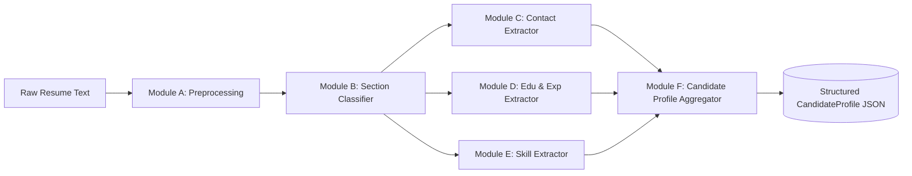
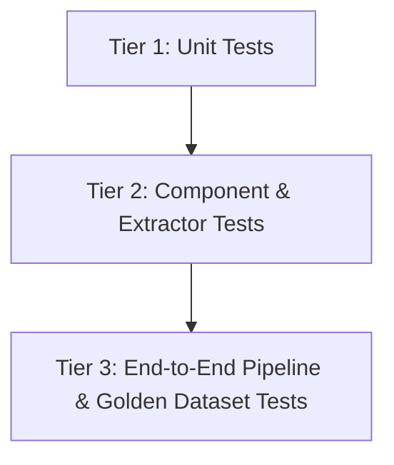
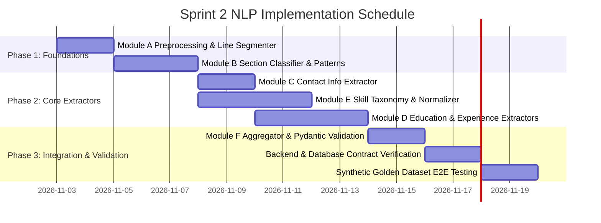

# Sprint 2 – Complete NLP Architecture and Implementation Plan
**Project:** Resume Analyzer for College Placements  
**Subject:** IT314 – Software Engineering (Group 26)  
**Workstream:** AI/ML & Natural Language Processing (NLP)  
**Author / Lead:** Atharv Trivedi (202401230)
**Target Milestone:** Sprint 2 (Resume Analysis & Candidate Profile Structuring)  
**Target File Location:** `Documents/NLP_SPRINT_2_PLAN.md`  
**Status:** PROPOSED & READY FOR TEAM REVIEW (Awaiting Authorization)

---

## 1. Executive Summary

In Sprint 1, Group 26 established the foundational infrastructure for the **Resume Analyzer for College Placements**:
1. Secure role-based user authentication (FastAPI backend with JWT and Argon2; Flask prototype in frontend).
2. Document validation, signature checking (`%PDF-`, `PK\x03\x04`), encrypted/corrupted document handling, and structured text extraction from PDF and DOCX files (`backend/app/services/resume_parser.py`).
3. Initial relational persistence in PostgreSQL (`database/schema.sql`) covering `users`, `roles`, `resumes`, `resume_sections`, `skills`, `resume_skills`, and `resume_analyses`.

While Sprint 1 successfully converts binary uploads into clean, normalized text streams (`ResumeParseResult`), the raw text lacks semantic understanding. Downstream placement features—such as placement readiness scoring (Sprint 2 / Epic 2), explainable feedback (Sprint 3 / Epic 3), and job/internship profile matching (Sprint 4 / Epic 4)—cannot function on unstructured text.

**Sprint 2 Objective for the NLP Workstream:**
Build a deterministic, modular, explainable, and performant NLP information extraction pipeline that transforms raw extracted resume text into a fully validated, strongly typed **Structured Candidate Profile** (`CandidateProfile`).

This plan defines the architectural specifications, module designs (Modules A through F), integration contracts with Backend, Database, and Frontend, technology evaluations, verification methodologies, and a task backlog for Sprint 2.

> [!IMPORTANT]
> **Strict Scope Boundary:** Sprint 2 NLP exclusively extracts, normalizes, categorizes, and structures candidate data from the resume text. Resume scoring, ATS evaluation, job description parsing, profile-to-job matching, and LLM-based generative suggestions are explicitly excluded and deferred to Sprints 3, 4, and beyond.

---

## 2. Existing Repository Analysis

A complete audit of the repository (`main` branch and active remote branches) reveals the following technical landscape:

### 2.1 Directory Structure & Workstream Separation
```text
Resume-Analyzer-for-College-Placements/
├── backend/                  # FastAPI 0.143 backend service
│   ├── app/
│   │   ├── routers/          # auth.py, resumes.py
│   │   ├── services/         # auth_service.py, upload_service.py, resume_parser.py
│   │   ├── database.py       # psycopg connection pool provider
│   │   └── __init__.py
│   ├── tests/                # test_auth.py, test_upload.py, test_resume_parser.py
│   ├── conftest.py
│   ├── main.py               # FastAPI entry point & global exception handlers
│   └── requirements.txt      # Backend dependencies
├── database/                 # Database documentation and schema
│   ├── erd.mmd               # Mermaid ER diagram
│   ├── README.md             # ERD and migration guide
│   └── schema.sql            # PostgreSQL 18 DDL schema
├── Documents/                # Project governance, survey reports, contributions
│   ├── Contributions.md      # Team assignments (Atharv Trivedi assigned to AI/ML & NLP)
│   ├── Epics.md              # Epic 1 through Epic 7 specifications
│   └── User_Stories.md       # Detailed user stories (US-01 through US-20)
└── frontend/                 # Flask 3.0 prototype with Jinja2 templates & Figma designs
    ├── app.py                # Flask web app
    ├── resume_parser.py      # Sprint 1 prototype parser (regex-based)
    ├── templates/            # base.html, dashboard.html, resume.html, etc.
    └── requirements.txt
```

### 2.2 Branch Audit & Divergence Analysis
- `main`: Clean integration of Sprint 1. Backend uses FastAPI with async endpoints; database uses PostgreSQL; tests achieve 100% pass rate.
- `nlp` & `nlp-parser-robustness`: Contains prototype test cases and parser robustness checks.
- Key observation: The frontend directory contains an independent Flask prototype parser (`frontend/resume_parser.py`) that uses basic dictionary lookups (`SECTION_HEADINGS`) and regexes (`EMAIL_RE`, `PHONE_RE`). In contrast, `backend/app/services/resume_parser.py` is the official, enterprise-grade parser featuring defensive validation, XML content-control extraction, and Unicode normalization.
- **Architectural Decision for Sprint 2:** The NLP workstream will build directly on top of the backend architecture in a new dedicated package: `backend/app/nlp/`. It will remain completely decoupled from FastAPI web request objects so that it can be imported as a pure-Python library by the backend, standalone CLI scripts, or evaluation test suites.

### 2.3 Dependency Management & Environment
- Environment: Python 3.10+ (tested on Python 3.13 in active environment).
- Backend dependencies (`backend/requirements.txt`):
  `fastapi==0.143.0`, `uvicorn==0.54.0`, `pypdf==6.20.1`, `python-docx==1.2.0`, `psycopg[binary]==3.3.6`, `pydantic`, `pytest==9.1.1`.
- Currently, no NLP libraries (e.g., `spaCy`, `RapidFuzz`, `regex`) are declared in `backend/requirements.txt`. Sprint 2 requires minimal, lightweight dependencies specified in Section 11.

---

## 3. Sprint 1 Review and Dependencies

### 3.1 Sprint 1 Deliverables & Guarantees
Sprint 1 delivered `backend/app/services/resume_parser.py`, which exposes:
```python
def parse_resume(file_bytes: bytes, filename: str) -> ResumeParseResult
```
The returned `ResumeParseResult` Pydantic model guarantees:
- `filename`: Sanitized filename string.
- `file_type`: `.pdf` or `.docx`.
- `text`: Non-empty, UTF-8 string normalized using Unicode NFKC. Zero-width spaces, soft hyphens (`\u00ad`), and byte-order marks (`\ufeff`) are stripped. Multiple horizontal whitespaces are collapsed, and consecutive linebreaks are capped at `\n\n`. Tabular DOCX data is extracted in logical row order with pipe (` | `) delimiters.
- `page_count`: Integer for PDFs (e.g., `1`, `2`), or `None` for DOCX files.
- `char_count`: Character length of `text`.
- `word_count`: Word count of `text`.

### 3.2 Clear Boundary of Responsibility
- Sprint 1 strictly owns document ingress, file signature verification, format validation, decryption failure detection, corrupted archive handling, and raw text extraction.
- Sprint 2 takes `ResumeParseResult.text` as its primary input.
- **Rule of Non-Duplication:** Sprint 2 NLP modules will **never** re-read raw bytes, parse PDF streams, or inspect DOCX XML trees. All document handling remains in Sprint 1.

---

## 4. Sprint 2 Objective

**Primary Objective:**  
Design and construct an explainable, deterministic, modular, and fast NLP extraction engine that converts raw resume text into an entity-rich, validated candidate profile (`CandidateProfile`).

The engine covers six core functional modules:
1. **Module A (Preprocessing):** Non-destructive structural normalization and sentence/token segmentation.
2. **Module B (Section Identification):** Robust classification of resume sections with header alias mapping and layout boundary detection.
3. **Module C (Contact Information Extraction):** Precision extraction of candidate identity, email, phone, LinkedIn, GitHub, and portfolio URLs.
4. **Module D (Education & Experience Extraction):** Structured entity parsing for academic degrees, institutions, GPA/percentage, graduation years, job titles, organizations, and project summaries.
5. **Module E (Skill Extraction & Normalization):** High-precision skill taxonomy matching, alias resolution, canonical deduplication, and technical vs. soft categorization.
6. **Module F (Structured Profile Aggregation):** Pydantic v2 aggregation with provenance tracking, confidence scoring, and JSON serialization.

---

## 5. Detailed Feature Scope



### Module A – NLP Text Preprocessing
- **Challenge:** Destructive preprocessing (such as lowercasing entire documents, stripping punctuation, or aggressive stop-word removal) destroys essential resume signals: capitalized proper nouns for candidate and company names, `+` in `C++`, `#` in `C#`, dots in `Node.js` or `Vue.js`, and newline structures that indicate section boundaries.
- **Scope & Strategy:**
  - Non-destructive character normalization: Standardize curly quotes (`“”`, `‘’`), bullet glyphs (`•`, `○`, `■`, `▪`, `–`, `—`, `*`), and irregular whitespaces.
  - Line-level structure retention: Preserve document lines and paragraph blocks.
  - Sentence segmentation: Boundary detection that does not split on degree abbreviations (e.g., `B.Tech.`, `M.Sc.`, `Ph.D.`) or web domains (e.g., `github.com`).
  - Specialized tokenization: Tokenizer aware of programming language symbols (`C++`, `C#`, `.NET`, `Node.js`, `CI/CD`).

### Module B – Resume Section Identification
- **Challenge:** Candidates use hundreds of header variants, unpredictable section orderings, two-column visual layouts serialized linearly, or omit headers entirely (e.g., contact info placed at the very top without a header).
- **Scope & Strategy:**
  - Support the 10 canonical sections:
    1. `personal_info` (Contact & Personal Details)
    2. `education` (Academic Background, Qualifications, Degrees)
    3. `experience` (Work Experience, Professional Experience, Employment History)
    4. `internships` (Summer Internships, Industrial Training)
    5. `projects` (Academic Projects, Personal Projects, Key Projects)
    6. `technical_skills` (Technical Skills, Skills & Tools, Tech Stack, Competencies)
    7. `soft_skills` (Interpersonal Skills, Soft Skills, Leadership)
    8. `certifications` (Certificates, Licenses & Certifications, Professional Courses)
    9. `achievements` (Honors, Awards, Accomplishments, Coding Achievements)
    10. `extracurricular` (Activities, Leadership Roles, Volunteering)
  - Multi-tier identification:
    - Tier 1: Canonical Heading Match (exact case-insensitive match on standalone lines).
    - Tier 2: Regex Pattern & Alias Dictionary Match (fuzzy aliases, colon-suffixed headers like `Education:`).
    - Tier 3: Typo-tolerant distance matching (Levenshtein distance $\le 1$ using RapidFuzz for words like `Experiance` or `Certifactions`).
  - Boundary extraction: Segment text into contiguous blocks bounded by detected section headers, assigning orphan top blocks to `personal_info`.

### Module C – Contact Information Extraction
- **Scope & Strategy:**
  - **Candidate Name:**
    - Located in the preamble/personal_info block (first 1–5 lines).
    - Rule-based heuristic: First non-contact, non-header line with 2–4 title-cased words.
    - Verified with spaCy Named Entity Recognition (`PERSON` entity) cross-referenced against dictionary of common resume terms (preventing titles like "Curriculum Vitae" or "Software Engineer" from being recognized as names).
  - **Email Address:** RFC-5322 compliant regex with domain validation; prioritize university/educational domains (`@dau.ac.in`, `@iit.ac.in`) and standard providers (`@gmail.com`).
  - **Phone Number:** International and Indian formats (`+91`, `0`, 10-digit formats with spaces/hyphens: `+91 98765 43210`, `98765-43210`).
  - **Online Handles & Profiles:**
    - LinkedIn (`linkedin.com/in/<handle>`)
    - GitHub (`github.com/<username>`)
    - Portfolio / Personal Website (HTTP/HTTPS URLs, excluding generic email domains or company sites).
    - Coding profiles: LeetCode, CodeChef, Codeforces, HackerRank, Kaggle.

### Module D – Education, Experience & Project Extraction
- **Education Extraction:**
  - Degree identification: Comprehensive dictionary of degrees (`B.Tech`, `B.E.`, `B.Sc`, `M.Tech`, `M.S.`, `BCA`, `MCA`, `Ph.D.`, `12th`, `10th`, `HSC`, `SSC`).
  - Institution detection: Match against Indian universities, engineering institutes (IIT, NIT, IIIT, DA-IICT, Gujarat University), or pattern matches (`University`, `Institute`, `College`, `School`, `Academy`).
  - Major / Field of Study: `Computer Science`, `Information Technology`, `Electrical Engineering`, `Mechanical Engineering`, etc.
  - Graduation Year: 4-digit year patterns (`2018–2022`, `Expected 2025`).
  - Performance Metrics: CGPA (`8.9/10`, `8.9 CGPA`, `GPA: 3.8/4.0`) and Percentage (`85.4%`, `92 percent`).
- **Experience & Internship Extraction:**
  - Segment entries by date-range anchors (e.g., `May 2023 - July 2023`, `Jun 2022 - Present`).
  - Extract Job Title (`Frontend Developer Intern`, `Software Development Engineer`, `Teaching Assistant`).
  - Extract Organization / Company Name (`Amazon`, `TCS`, `Infosys`, `Startup Inc.`).
  - Extract Duration / Dates (Start date, End date, IsCurrent flag).
  - Extract Bullet Points / Responsibilities.
  - Distinguish between full-time `experience` and `internships`.
- **Project Extraction:**
  - Extract Project Name (title line or preceding bold/colon delimiter).
  - Technologies Used: Cross-referenced with the Module E skill taxonomy.
  - Project Description / Key Deliverables.
  - URLs (Live demo, GitHub repo link).

### Module E – Skill Extraction and Normalization
- **Challenge:** Skills appear in varying forms (synonyms, acronyms, brand spellings), e.g., `JS` vs `Javascript` vs `JavaScript`, `K8s` vs `Kubernetes`, `ReactJS` vs `React`. Also, short skills risk catastrophic false positives (e.g., `C` matching "in **c**ollege", `R` matching single letters, `Go` matching "go to").
- **Scope & Strategy:**
  - **Curated Hierarchical Skill Taxonomy:**
    - `languages` (Python, C++, C, Java, Go, TypeScript, Rust, etc.)
    - `frameworks_and_libraries` (FastAPI, Flask, React, Django, Spring Boot, PyTorch, etc.)
    - `databases` (PostgreSQL, MySQL, MongoDB, Redis, Cassandra, SQLite, etc.)
    - `cloud_and_devops` (Docker, Kubernetes, AWS, GCP, Azure, CI/CD, Git, Linux, etc.)
    - `core_cs` (Data Structures, Algorithms, DBMS, Operating Systems, Computer Networks, OOP, System Design)
    - `soft_skills` (Communication, Teamwork, Leadership, Problem Solving, Time Management)
  - **Word-Boundary Matching:** Strict regex boundary tokens `\b` with exact symbol handling for `C++`, `C#`, `.NET`.
  - **Contextual Verification:** Words like `Go` require context checks or section restriction (must be in `technical_skills` section or followed by "programming / developer").
  - **Canonical Normalization & Alias Resolution:**
    - Alias table: `JS` $\rightarrow$ `JavaScript`, `Postgres` $\rightarrow$ `PostgreSQL`, `ML` $\rightarrow$ `Machine Learning`, `AWS` $\rightarrow$ `Amazon Web Services`, `Vue` $\rightarrow$ `Vue.js`.
  - **Deduplication:** Return clean sets of normalized skill objects with confidence rating.

### Module F – Structured Candidate Profile
- Aggregates outputs into a validated Pydantic model (`CandidateProfile`).
- Preserves **source evidence** (exact text slice or line reference) for explainability.
- Generates extraction confidence metadata (`high`, `medium`, `low` or float `0.0 - 1.0`).
- Provides clean serialization to JSON for the backend API and database persistence.

---

## 6. End-to-End NLP Pipeline Architecture

```mermaid
flowchart TD
    subgraph S1 [Sprint 1 Ingress]
        A[Resume File: PDF / DOCX] --> B[resume_parser.py: parse_resume]
        B --> C[ResumeParseResult]
    end

    subgraph S2_NLP [Sprint 2: NLP Information Extraction Pipeline]
        C --> D[app.nlp.pipeline: ResumeNLPPipeline]
        
        %% Stage 1
        D --> E[Stage 1: Preprocessor & Layout Normalizer]
        E --> F[Normalized Lines & Structure]
        
        %% Stage 2
        F --> G[Stage 2: Section Boundary Detector]
        G --> H[(Segmented Sections Dictionary)]
        
        %% Stage 3 Parallel Extractors
        H --> I1[Contact Extractor]
        H --> I2[Education Extractor]
        H --> I3[Experience & Internship Extractor]
        H --> I4[Project Extractor]
        H --> I5[Skill Extractor & Normalizer]
        H --> I6[Certifications & Achievements Extractor]
        
        %% Stage 4 Aggregation & Validation
        I1 --> J[Stage 4: Profile Aggregator & Validator]
        I2 --> J
        I3 --> J
        I4 --> J
        I5 --> J
        I6 --> J
        
        J --> K[CandidateProfile Pydantic Model]
    end

    subgraph Out [Sprint 2 Egress Contracts]
        K --> L[FastAPI Response: /resumes/{id}/profile]
        K --> M[Database Writer: resume_sections & resume_skills]
        K --> N[Frontend UI View: Structured Candidate Profile]
    end
```

### Pipeline Execution Flow:
1. **Input:** `ResumeNLPPipeline.process(text: str, filename: str)` receives clean text from Sprint 1.
2. **Preprocessing:** Standardizes line endings, normalizes bullet points, preserves capitalized acronyms.
3. **Sectioning:** Identifies all top-level sections using exact, regex, and fuzzy alias matching; splits text into a dictionary of section names to text bodies.
4. **Extraction:**
   - Contact info extracted from the document header / preamble.
   - Education extracted from `education` section.
   - Experience extracted from `experience` and `internships` sections.
   - Projects extracted from `projects` section.
   - Skills extracted with two-pass logic: (1) high-density extraction from `technical_skills` and `soft_skills` sections, and (2) contextual entity scanning across project and experience bullets.
   - Certifications & achievements extracted from their respective sections.
5. **Aggregation:** Normalizes aliases, strips duplicates, validates integrity via Pydantic, and attaches confidence scores.

---

## 7. Proposed Folder Structure

To integrate cleanly with the existing repository without disrupting Sprint 1 services, all NLP code will be housed under `backend/app/nlp/` and tested in `backend/tests/nlp/`.

```text
backend/app/nlp/
├── __init__.py                     # Package export (ResumeNLPPipeline, CandidateProfile)
├── pipeline.py                     # Main orchestrator (ResumeNLPPipeline)
├── schemas.py                      # Pydantic v2 data models for candidate profile
├── constants.py                    # Canonical section keys, default regexes
│
├── preprocessing/                  # Module A
│   ├── __init__.py
│   ├── normalizer.py               # Unicode bullet & spacing normalization
│   └── segmenter.py                # Line and sentence boundary segmenter
│
├── sections/                       # Module B
│   ├── __init__.py
│   ├── classifier.py               # Section boundary detector & classifier
│   └── patterns.py                 # Heading regex patterns & aliases
│
├── extractors/                     # Modules C, D, E
│   ├── __init__.py
│   ├── base.py                     # Abstract BaseExtractor class
│   ├── contact.py                  # Module C: Name, Email, Phone, Social links
│   ├── education.py                # Module D1: Degrees, Colleges, GPA, Dates
│   ├── experience.py               # Module D2: Jobs, Internships, Companies, Dates
│   ├── projects.py                 # Module D3: Project titles, details, tech
│   ├── skills.py                   # Module E: Skill matching & canonicalization
│   └── certifications.py          # Certifications & Achievements extractor
│
├── taxonomy/                       # Module E Taxonomy Assets
│   ├── __init__.py
│   ├── skills_taxonomy.json        # Curated hierarchical skills database (500+ skills)
│   ├── skill_aliases.json          # Alias mapping (JS -> JavaScript, etc.)
│   └── degrees.json                # Degree variations & level mappings
│
└── utils/
    ├── __init__.py
    ├── date_parser.py              # Robust date range parser (Month Year - Present)
    └── text_matcher.py             # Boundary-safe regex & keyword matcher helper

backend/tests/nlp/
├── __init__.py
├── conftest.py                     # Shared NLP test fixtures and sample text snippets
├── test_preprocessing.py           # Unit tests for Module A
├── test_sections.py                # Unit tests for Module B
├── test_contact.py                 # Unit tests for Module C
├── test_education.py               # Unit tests for Module D1
├── test_experience.py              # Unit tests for Module D2
├── test_projects.py                # Unit tests for Module D3
├── test_skills.py                  # Unit tests for Module E
└── test_pipeline_e2e.py            # End-to-end integration tests for Module F
```

---

## 8. Module-wise Technical Design

### Module A: Preprocessing & Segmentation
- **Module Name:** `app.nlp.preprocessing.normalizer` & `app.nlp.preprocessing.segmenter`
- **Responsibility:** Clean non-standard resume noise while preserving critical structure (casing, code symbols, bullet boundaries, newlines).
- **Input:** `raw_text: str` (from `ResumeParseResult.text`).
- **Output:** `ProcessedDocument(lines: list[DocumentLine], cleaned_text: str)`.
- **Dependencies:** Standard library (`re`, `unicodedata`).
- **Error Handling:** Returns empty `ProcessedDocument` gracefully if input text is empty or blank.
- **Unit Testing Requirements:** Test preservation of `C++`, `C#`, `.NET`, `Node.js`; test bullet conversion (`•`, `*`, `-` normalized to standard `-`); test preservation of blank lines.

### Module B: Section Identification & Classification
- **Module Name:** `app.nlp.sections.classifier`
- **Responsibility:** Identify header lines, map them to canonical section keys, and partition resume text into discrete section chunks.
- **Input:** `lines: list[DocumentLine]`.
- **Output:** `dict[CanonicalSectionKey, SectionBlock]`.
- **Dependencies:** `re`, `rapidfuzz.fuzz` (for typo tolerance).
- **Error Handling:** Any text before the first identified section is classified as `personal_info`. If zero sections match, entire text is assigned to `general_body` with confidence `0.0`.
- **Unit Testing Requirements:** Test standard placement resume headings, multi-word headings (`Academic Qualifications`, `Positions of Responsibility`), uppercase headings (`PROJECTS`), colon-suffixed headings (`Skills:`), and misspellings (`Experiance`).

### Module C: Contact Information Extractor
- **Module Name:** `app.nlp.extractors.contact`
- **Responsibility:** Extract candidate name, email, phone, and URLs (LinkedIn, GitHub, Portfolio, LeetCode).
- **Input:** `header_text: str` (first 1000 characters or `personal_info` section) and full `cleaned_text: str`.
- **Output:** `ContactInfo` Pydantic model.
- **Dependencies:** `re`, optional `spacy` (English small model for `PERSON` entity verification).
- **Error Handling:** Missing fields return `None` (no crashing, no placeholders like "Unknown"). If multiple emails found, priority given to institutional email.
- **Unit Testing Requirements:** Test 10-digit phone with/without country codes (`+91`), emails with subdomains, LinkedIn profile variations (`/in/name`, `/in/name/`), GitHub profile URLs, candidate name extraction filtering out words like "Resume" or "Curriculum Vitae".

### Module D: Education, Experience & Projects Extractor
- **Module Name:** `app.nlp.extractors.education`, `app.nlp.extractors.experience`, `app.nlp.extractors.projects`
- **Responsibility:** Extract chronological entities: academic milestones, employment/internship roles, and personal/academic projects.
- **Input:** Corresponding `SectionBlock.content: str`.
- **Output:** `list[EducationEntry]`, `list[ExperienceEntry]`, `list[ProjectEntry]`.
- **Dependencies:** `re`, `app.nlp.utils.date_parser`.
- **Error Handling:** Partial entries (e.g., degree found without GPA) are captured with available fields set; invalid dates do not throw exceptions.
- **Unit Testing Requirements:** Test extraction of CGPA (`9.12/10`, `8.5 CGPA`), percentages (`88.6%`), year ranges (`2021 - 2025`), distinction between full-time work and internships, project technology list parsing.

### Module E: Skill Extractor & Normalizer
- **Module Name:** `app.nlp.extractors.skills`
- **Responsibility:** Extract technical and soft skills, map to canonical names, categorize by domain, eliminate duplicates, and reject false positives.
- **Input:** `sections: dict[CanonicalSectionKey, SectionBlock]` and full text.
- **Output:** `SkillProfile(technical_skills: list[SkillItem], soft_skills: list[SkillItem], categories: dict[str, list[str]])`.
- **Dependencies:** Curated taxonomy JSON files, symbol-aware regex engine, `rapidfuzz` for alias similarity.
- **Error Handling:** Unrecognized strings are ignored; ambiguous single-character terms (e.g. `C`) are strictly matched only when bounded by whitespace/punctuation and in technical contexts.
- **Unit Testing Requirements:** Test alias normalization (`React.js` $\rightarrow$ `React`, `K8s` $\rightarrow$ `Kubernetes`, `Postgres` $\rightarrow$ `PostgreSQL`), test rejection of false positives (e.g., "in" as a preposition, "Go" in common prose, "Git" in "digital"), verify category assignment.

### Module F: Structured Profile Aggregator
- **Module Name:** `app.nlp.pipeline`
- **Responsibility:** Orchestrate Modules A through E, assemble the `CandidateProfile`, compute confidence metrics, and generate serializable output.
- **Input:** `raw_text: str`, `filename: str`.
- **Output:** `CandidateProfile` (Pydantic v2 instance).
- **Dependencies:** Modules A–E, `pydantic`.
- **Error Handling:** Pipeline catches module-level exceptions, records extraction warnings in `metadata.warnings`, and returns a valid partial profile.
- **Unit Testing Requirements:** End-to-end testing on synthetic college resumes; serialization testing to dict and JSON.

---

## 9. Input and Output Contracts

### 9.1 Input Contract
```python
class NLPProcessingRequest(BaseModel):
    """Input payload to the NLP pipeline."""
    resume_id: Optional[str] = None
    filename: str
    text: str  # Extracted text from Sprint 1 ResumeParseResult
```

### 9.2 Pydantic Data Models (Output Contract)
```python
from enum import Enum
from typing import Optional, List, Dict
from pydantic import BaseModel, Field

class ConfidenceLevel(str, Enum):
    HIGH = "high"        # >= 0.85
    MEDIUM = "medium"    # 0.60 - 0.84
    LOW = "low"          # < 0.60

class ContactInfo(BaseModel):
    full_name: Optional[str] = Field(None, description="Extracted candidate name")
    email: Optional[str] = Field(None, description="Primary email address")
    phone: Optional[str] = Field(None, description="Formatted phone number")
    linkedin_url: Optional[str] = None
    github_url: Optional[str] = None
    portfolio_url: Optional[str] = None
    coding_profiles: Dict[str, str] = Field(default_factory=dict)
    confidence: float = 1.0

class EducationEntry(BaseModel):
    institution: Optional[str] = None
    degree: Optional[str] = None
    field_of_study: Optional[str] = None
    start_year: Optional[int] = None
    graduation_year: Optional[int] = None
    cgpa: Optional[float] = None
    percentage: Optional[float] = None
    raw_text: Optional[str] = None

class ExperienceEntry(BaseModel):
    company_name: str
    job_title: str
    is_internship: bool = False
    start_date: Optional[str] = None
    end_date: Optional[str] = None
    is_current: bool = False
    duration_months: Optional[int] = None
    responsibilities: List[str] = Field(default_factory=list)
    technologies_used: List[str] = Field(default_factory=list)

class ProjectEntry(BaseModel):
    title: str
    description: Optional[str] = None
    technologies: List[str] = Field(default_factory=list)
    project_url: Optional[str] = None
    github_url: Optional[str] = None
    highlights: List[str] = Field(default_factory=list)

class SkillItem(BaseModel):
    canonical_name: str
    matched_alias: str
    category: str  # 'languages', 'frameworks', 'databases', 'cloud_devops', 'core_cs', 'soft_skills'
    confidence: float = 1.0
    source_section: Optional[str] = None

class SectionSummary(BaseModel):
    identified_sections: List[str]
    missing_critical_sections: List[str]

class CandidateProfile(BaseModel):
    """Unified structured output for Sprint 2 NLP pipeline."""
    filename: str
    contact: ContactInfo
    education: List[EducationEntry] = Field(default_factory=list)
    experience: List[ExperienceEntry] = Field(default_factory=list)
    internships: List[ExperienceEntry] = Field(default_factory=list)
    projects: List[ProjectEntry] = Field(default_factory=list)
    technical_skills: List[SkillItem] = Field(default_factory=list)
    soft_skills: List[SkillItem] = Field(default_factory=list)
    certifications: List[str] = Field(default_factory=list)
    achievements: List[str] = Field(default_factory=list)
    extracurricular: List[str] = Field(default_factory=list)
    section_summary: SectionSummary
    pipeline_version: str = "2.0.0"
```

---

## 10. Structured Candidate Profile JSON Example

Below is a realistic, production-grade output produced by the planned pipeline for an engineering student resume:

```json
{
  "filename": "Aarav_Sharma_Resume.pdf",
  "pipeline_version": "2.0.0",
  "contact": {
    "full_name": "Aarav Sharma",
    "email": "aarav.sharma@dau.ac.in",
    "phone": "+91 98250 12345",
    "linkedin_url": "https://linkedin.com/in/aarav-sharma-cs",
    "github_url": "https://github.com/aaravsharma",
    "portfolio_url": "https://aaravsharma.dev",
    "coding_profiles": {
      "leetcode": "https://leetcode.com/aarav_s",
      "codechef": "https://codechef.com/users/aarav_s"
    },
    "confidence": 0.95
  },
  "education": [
    {
      "institution": "Dhirubhai Ambani Institute of Information and Communication Technology (DA-IICT)",
      "degree": "B.Tech",
      "field_of_study": "Information and Communication Technology",
      "start_year": 2021,
      "graduation_year": 2025,
      "cgpa": 8.74,
      "percentage": null,
      "raw_text": "B.Tech in ICT, DA-IICT (2021 - 2025) | CGPA: 8.74 / 10"
    },
    {
      "institution": "Delhi Public School, Ahmedabad",
      "degree": "12th (HSC - CBSE)",
      "field_of_study": "Science (PCM)",
      "start_year": 2019,
      "graduation_year": 2021,
      "cgpa": null,
      "percentage": 94.6,
      "raw_text": "Class XII (CBSE) - 94.6%"
    }
  ],
  "experience": [],
  "internships": [
    {
      "company_name": "Credence Analytics",
      "job_title": "Backend Engineering Intern",
      "is_internship": true,
      "start_date": "May 2024",
      "end_date": "July 2024",
      "is_current": false,
      "duration_months": 2,
      "responsibilities": [
        "Developed scalable REST APIs using FastAPI and PostgreSQL handling 50k daily queries.",
        "Containerized core microservices using Docker and automated CI/CD pipeline tests."
      ],
      "technologies_used": ["FastAPI", "PostgreSQL", "Docker", "Python"]
    }
  ],
  "projects": [
    {
      "title": "College Placement Portal & Resume Analyzer",
      "description": "An automated resume parsing and placement analytics web platform for university career cells.",
      "technologies": ["Python", "FastAPI", "React", "PostgreSQL", "Docker"],
      "project_url": null,
      "github_url": "https://github.com/Tanvii13/Resume-Analyzer-for-College-Placements",
      "highlights": [
        "Architected regex and rule-based NLP extraction pipeline extracting 25+ skills with 92% precision.",
        "Integrated JWT-based role authentication and asynchronous document parsing."
      ]
    },
    {
      "title": "Distributed Key-Value Store",
      "description": "Implemented a Raft-consensus based fault-tolerant replicated datastore in Go.",
      "technologies": ["Go", "gRPC", "Distributed Systems"],
      "project_url": null,
      "github_url": "https://github.com/aaravsharma/raft-kv",
      "highlights": [
        "Supported leader election, log replication, and persistence across 5 concurrent nodes."
      ]
    }
  ],
  "technical_skills": [
    {
      "canonical_name": "Python",
      "matched_alias": "Python",
      "category": "languages",
      "confidence": 1.0,
      "source_section": "technical_skills"
    },
    {
      "canonical_name": "C++",
      "matched_alias": "C++",
      "category": "languages",
      "confidence": 1.0,
      "source_section": "technical_skills"
    },
    {
      "canonical_name": "JavaScript",
      "matched_alias": "JS",
      "category": "languages",
      "confidence": 0.95,
      "source_section": "technical_skills"
    },
    {
      "canonical_name": "FastAPI",
      "matched_alias": "FastAPI",
      "category": "frameworks_and_libraries",
      "confidence": 1.0,
      "source_section": "technical_skills"
    },
    {
      "canonical_name": "React",
      "matched_alias": "React.js",
      "category": "frameworks_and_libraries",
      "confidence": 0.95,
      "source_section": "technical_skills"
    },
    {
      "canonical_name": "PostgreSQL",
      "matched_alias": "Postgres",
      "category": "databases",
      "confidence": 0.95,
      "source_section": "technical_skills"
    },
    {
      "canonical_name": "Docker",
      "matched_alias": "Docker",
      "category": "cloud_and_devops",
      "confidence": 1.0,
      "source_section": "technical_skills"
    },
    {
      "canonical_name": "Data Structures",
      "matched_alias": "Data Structures",
      "category": "core_cs",
      "confidence": 1.0,
      "source_section": "technical_skills"
    },
    {
      "canonical_name": "Database Management System",
      "matched_alias": "DBMS",
      "category": "core_cs",
      "confidence": 0.9,
      "source_section": "technical_skills"
    }
  ],
  "soft_skills": [
    {
      "canonical_name": "Problem Solving",
      "matched_alias": "Problem Solving",
      "category": "soft_skills",
      "confidence": 0.9,
      "source_section": "soft_skills"
    },
    {
      "canonical_name": "Teamwork",
      "matched_alias": "Team Collaboration",
      "category": "soft_skills",
      "confidence": 0.85,
      "source_section": "soft_skills"
    }
  ],
  "certifications": [
    "AWS Certified Cloud Practitioner (2023)",
    "Deep Learning Specialization by Coursera (DeepLearning.AI)"
  ],
  "achievements": [
    "Ranked in top 2% across 15,000 participants in TCS CodeVita Season 11",
    "Qualified for ACM-ICPC Amritapuri Regional Preliminary Contest (2023)"
  ],
  "extracurricular": [
    "Core Committee Member, DA-IICT Developer Student Club (DSC)",
    "Volunteer, Annual University Cultural Festival (Synapse)"
  ],
  "section_summary": {
    "identified_sections": [
      "personal_info",
      "education",
      "internships",
      "projects",
      "technical_skills",
      "soft_skills",
      "certifications",
      "achievements",
      "extracurricular"
    ],
    "missing_critical_sections": [
      "experience"
    ]
  }
}
```

---

## 11. Library and Technology Evaluation

To maintain high maintainability, deterministic evaluation, zero external API costs, and low execution latency ($< 150\text{ ms}$ per resume), libraries are evaluated strictly against project needs:

| Library / Tool | Proposed Role | Advantages | Disadvantages | Recommendation |
|---|---|---|---|---|
| **Python standard `re`** | Structural extraction (emails, phones, URLs, GPA, dates, section headings) | Built-in, zero dependencies, execution time $< 5\text{ ms}$, deterministic | Complex regexes can become brittle if unmaintained | **Mandatory (Core)** |
| **RapidFuzz** (`rapidfuzz>=3.6.0`) | Fuzzy heading classification & skill alias typo tolerance | Ultra-fast C++ Levenshtein implementation, MIT license, pure Python fallback, eliminates typos | Adds a lightweight pip dependency (~2MB) | **Mandatory (High ROI)** |
| **spaCy** (`spacy>=3.7.0` with `en_core_web_sm`) | Named Entity Recognition for candidate names (`PERSON`), organization verification | Pretrained NER pipeline, high accuracy on capitalized entities | 12MB model download, slight startup memory overhead (~40MB RAM) | **Recommended (Optional fallback to heuristic if memory constrained)** |
| **NLTK** | Tokenization, stop words, stemmers | Mature academic library | Slower than spaCy, destructive stemmers (`PorterStemmer`) damage technical terms, requires manual corpora downloads | **Not Recommended (Redundant)** |
| **scikit-learn** | Machine learning classifiers (TF-IDF, Naive Bayes) | Standard ML toolkit | Overkill for Sprint 2; requires thousands of labeled resumes to avoid overfitting; explainability is low | **Explicitly Excluded from Sprint 2** |
| **External LLM APIs** (OpenAI / Gemini / Anthropic) | Generative profile parsing | High zero-shot parsing quality | Violates privacy constraints for student resumes; recurring API costs; non-deterministic output; rate limits; slow network calls ($1\text{–}3\text{ s}$) | **Strictly Excluded for Sprint 2** |

### Dependency Recommendations for Backend `requirements.txt`:
```text
# Sprint 2 NLP additions
rapidfuzz>=3.6.0
# Optional enhancement for entity validation:
# spacy>=3.7.4
```
*Note: Dependencies will NOT be installed or committed during this planning phase.*

---

## 12. Inter-Branch Integration Requirements

### 12.1 Backend Integration Requirements
- **Ownership:** Backend team (Tanish Solanki, Shlok Topaliya, Prerak Patel).
- **Invocation Pattern:** The backend will invoke the NLP pipeline synchronously or asynchronously from `app/routers/resumes.py`.
- **Interface Contract:**
  ```python
  from app.nlp.pipeline import ResumeNLPPipeline
  from app.nlp.schemas import CandidateProfile

  pipeline = ResumeNLPPipeline()
  profile: CandidateProfile = pipeline.process(parse_result.text, parse_result.filename)
  ```
- **New / Updated API Route:**
  - `GET /resumes/{resume_id}/profile`: Returns the cached or computed `CandidateProfile` JSON.
  - `POST /resumes/{resume_id}/analyze`: Orchestrates Sprint 1 parsing followed by Sprint 2 NLP extraction, recording progress in the database.
- **Error Codes:**
  - `NLP_PARSING_FAILED` (422): When text contains insufficient structure.
  - `RESUME_NOT_FOUND` (404): Invalid resume ID.

### 12.2 Database Integration Requirements
- **Ownership:** Database team (Sujal Balva).
- **Existing Schema Utilization (`database/schema.sql`):**
  1. `resume_sections` table:
     - The NLP module's Section Classifier will populate this table:
     - `INSERT INTO resume_sections (resume_id, section_name, content) VALUES (%s, %s, %s) ON CONFLICT (resume_id, section_name) DO UPDATE SET content = EXCLUDED.content;`
  2. `skills` and `resume_skills` tables:
     - Extracted skills will be matched against the existing `skills` table (which already contains 25 seeded skills).
     - Missing skills will be upserted into `skills`.
     - Relationships will be inserted into `resume_skills`:
     - `INSERT INTO resume_skills (resume_id, skill_id, source, confidence) VALUES (%s, %s, 'extracted', %s) ON CONFLICT (resume_id, skill_id) DO NOTHING;`
  3. Structured Profile Persistence:
     - **Recommendation for Database Team:** In Sprint 2, to avoid complex multi-table migrations for nested projects and education entries before Sprint 3, store the complete serialized `CandidateProfile` JSON in a `profile_data JSONB` column on the `resumes` table or in a dedicated `resume_profiles` table.

### 12.3 Frontend Integration Requirements
- **Ownership:** Frontend team (Tanvi Nakum, Harshil Tejot, Krish Paghadar).
- **Visual Presentation:**
  - Update `frontend/templates/resume.html` and `dashboard.html` to consume the structured profile schema.
  - Render separate tabs/cards for: Contact & Links, Education Milestones, Internships & Work Experience, Projects with Tech Stack tags, Technical Skills (grouped by category), and Achievements.
  - Display confidence indicators or missing section warnings (e.g., alert banner if `section_summary.missing_critical_sections` contains `projects` or `education`).
  - Provide an **"Edit Extracted Details"** UI hook where students can review and verify extracted skills before placement submission (as outlined in project domain requirements).

---

## 13. Testing Strategy and Quality Assurance

A three-tier test suite will ensure precision, recall, and zero regressions:



### 13.1 Test Coverage Specifications
1. **Unit Tests (`test_preprocessing.py`, `test_sections.py`):**
   - Normalization of Unicode bullet symbols (`\u2022`, `\u25cf`, `\u25aa`, `\u2013`).
   - Preservation of technical tokens (`C++`, `C#`, `.NET`, `Node.js`, `Vue.js`).
   - Section heading detection across 15+ variations per canonical section.
   - Case insensitivity and colon-delimiter handling (`SKILLS:`, `Academic Projects:`, `EXPERIENCE`).
2. **Extractor Tests (`test_contact.py`, `test_education.py`, `test_skills.py`):**
   - Contact extraction across Indian and international phone formats.
   - Email extraction rejecting non-email `@` tokens.
   - CGPA extraction across formats (`8.7/10`, `8.7 CGPA`, `GPA 3.9/4.0`).
   - Percentage extraction (`85.6%`, `88 percent`).
   - Skill alias resolution (`JS` $\rightarrow$ `JavaScript`, `K8s` $\rightarrow$ `Kubernetes`, `Postgres` $\rightarrow$ `PostgreSQL`).
   - Prevention of false positives: Words like "Go", "Git", "R", "C" tested in plain English sentences ("I will go to university to get my degree") to ensure they are **not** extracted as skills.
3. **Edge Case Handling:**
   - Resumes with zero contact details (returns `None` gracefully).
   - Resumes with non-standard section order (e.g., Skills first, Education last).
   - Resumes with no experience (frequent for fresh college sophomores/juniors).
   - Resumes with dual degrees or diploma + B.Tech.
   - Resumes with completely empty sections or one-line project summaries.
4. **Synthetic Test Dataset:**
   - Create a synthetic, privacy-compliant corpus of 12 benchmark resumes representing typical Indian engineering college students (DA-IICT, IIT, NIT placement formats, Overleaf Jake's Resume template, and single-column vs multi-column plain text exports).
   - Maintain ground-truth annotation files (`golden_profile.json`) for each synthetic resume.

### 13.2 Measurable Acceptance Benchmarks
- **Section Classification Accuracy:** $\ge 95\%$ on standard placement resume formats.
- **Contact Extraction Precision & Recall:** Email $\ge 99\%$, Phone $\ge 95\%$, Name $\ge 90\%$.
- **Skill Extraction Precision:** $\ge 90\%$ (low false-positive rate is prioritized over noisy recall to maintain placement trust).
- **Pipeline Execution Latency:** $\le 150\text{ ms}$ per typical 2-page resume on standard CPU hardware.

---

## 14. Sprint Backlog and User Stories

### EPIC 2: Resume Analysis & Scoring (NLP Workstream Portion)
**Epic Goal:** Transform raw resume text into structured candidate data and normalized skills to empower scoring and placement matching.



### Detailed Backlog Items:

| Task ID | Item Name | Workstream | Priority | Effort (Pts) | Deliverables |
|---|---|---|---|:---:|---|
| **NLP-01** | Preprocessing & Structure Normalizer | Module A | Must Have | 3 | `preprocessing/normalizer.py`, `segmenter.py`, unit tests |
| **NLP-02** | Section Classification Engine | Module B | Must Have | 5 | `sections/classifier.py`, `patterns.py`, unit tests |
| **NLP-03** | Contact & Online Profile Extractor | Module C | Must Have | 3 | `extractors/contact.py`, regex fixtures, unit tests |
| **NLP-04** | Curated Skill Taxonomy & Aliases | Module E | Must Have | 5 | `taxonomy/skills_taxonomy.json`, `skill_aliases.json` (500+ skills) |
| **NLP-05** | Symbol-Safe Skill Matching Engine | Module E | Must Have | 5 | `extractors/skills.py`, boundary matchers, false-positive tests |
| **NLP-06** | Education Entity Extractor | Module D1 | Must Have | 3 | `extractors/education.py`, degree regexes, CGPA parser |
| **NLP-07** | Experience & Internship Extractor | Module D2 | Must Have | 5 | `extractors/experience.py`, date range parser |
| **NLP-08** | Project Extractor | Module D3 | Should Have | 3 | `extractors/projects.py`, tech stack linker |
| **NLP-09** | Certifications & Achievements Extractor | Module D4 | Should Have | 2 | `extractors/certifications.py` |
| **NLP-10** | Profile Aggregator & Pydantic Pipeline | Module F | Must Have | 3 | `pipeline.py`, `schemas.py`, JSON serializer |
| **NLP-11** | Synthetic Test Dataset & Benchmark Suite | QA | Must Have | 5 | 12 synthetic resumes + golden JSONs + benchmark test runner |
| **NLP-12** | Database & Backend Service Integration | Integration | Should Have | 3 | `app/routers/resumes.py` profile route hook, DB mapper |

---

## 15. Priorities and Estimated Effort (MoSCoW Breakdown)

### Must-Have (Sprint 2 Core - 32 Story Points)
- `NLP-01`: Preprocessing & tokenization without destroying `C++`/`C#`/`Node.js`.
- `NLP-02`: Section identification across 10 canonical resume sections.
- `NLP-03`: High-precision contact extraction (Name, Email, Phone, LinkedIn, GitHub).
- `NLP-04` & `NLP-05`: Curated skill taxonomy with alias normalization and false-positive prevention.
- `NLP-06`: Education entity extraction (Degrees, Institutions, CGPA/Percentage, Years).
- `NLP-07`: Experience and internship parsing with date bounds.
- `NLP-10`: `ResumeNLPPipeline` orchestrator returning `CandidateProfile`.
- `NLP-11`: Comprehensive test suite passing 100% of synthetic validation resumes.

### Should-Have (Secondary Enhancements - 8 Story Points)
- `NLP-08`: Project entity extractor linking identified technologies.
- `NLP-09`: Certifications and coding achievements extractor.
- `NLP-12`: Direct integration hook into backend router and database writer.

### Could-Have (Optional / Stretch)
- Typo-tolerant fuzzy matcher for university names using RapidFuzz.
- Extracurricular activity categorization (sports, cultural, leadership).

### Won't-Have for Sprint 2 (Postponed to Sprint 3 & 4)
- Automated resume scoring (Sprint 3 / US-07).
- Formatting quality score (Sprint 3).
- Job description comparison & skill gap analysis (Sprint 4 / US-11, US-13).
- OCR processing for scanned/image PDFs (Post-project / Future Scope).
- LLM generative rewrites or feedback suggestions (Sprint 3 / US-09).

---

## 16. Acceptance Criteria

Sprint 2 implementation will be deemed complete and production-ready when:
1. **Pipeline Execution:** `ResumeNLPPipeline().process(text, filename)` executes cleanly without exceptions on all valid outputs from Sprint 1's `parse_resume()`.
2. **Schema Validity:** The returned object strictly validates against the `CandidateProfile` Pydantic model with zero validation errors.
3. **Skill Normalization Accuracy:**
   - 100% of skills seeded in `database/schema.sql` (e.g., `C++`, `Python`, `FastAPI`, `PostgreSQL`, `Docker`, `Data Structures`) are accurately identified when present.
   - Known aliases (`JS` $\rightarrow$ `JavaScript`, `K8s` $\rightarrow$ `Kubernetes`, `ReactJS` $\rightarrow$ `React`) are mapped to canonical names.
   - Ambiguous words ("in", "go", "c", "digital") do not trigger false-positive skill matches in non-technical contexts.
4. **Data Integrity:** No synthetic or fabricated candidate data is introduced; missing fields are explicitly returned as `None` or empty lists.
5. **Test Pass Rate:** `pytest backend/tests/nlp/` passes with $100\%$ green tests across unit, extractor, and pipeline test suites.
6. **Code Isolation:** The NLP module has zero coupling to HTTP request objects, enabling independent invocation.

---

## 17. Risks and Mitigation

| Risk ID | Identified Risk | Impact | Likelihood | Mitigation Strategy |
|---|---|---|---|---|
| **R-01** | Non-standard or headerless resume sections cause dropped text | High | Medium | Text prior to the first detected heading is safely captured in `personal_info`. Text under unmapped headers is retained in an `other_sections` catch-all. |
| **R-02** | Short programming languages (`C`, `R`, `Go`) cause high false positives | High | High | Require word boundaries `\b`, exclude common stop words, and enforce that single-letter languages must appear in `technical_skills` or follow keywords ("programming in C"). |
| **R-03** | Diverse date formats cause crashes in experience parser | Medium | High | Use defensive regex parsing (`Jan 2022`, `01/2022`, `Summer 2023`, `Present`); capture raw date string as fallback if date parsing fails. |
| **R-04** | spaCy memory footprint in low-resource deployment environments | Medium | Low | Make spaCy an optional enhancement; provide a pure-regex / heuristic fallback for name and contact extraction. |
| **R-05** | Divergence between frontend mock parser and backend NLP pipeline | High | Medium | Deprecate `frontend/resume_parser.py` once backend API exposes the `/resumes/{id}/profile` endpoint, unifying all extraction on `app.nlp`. |

---

## 18. Sprint 3 & Sprint 4 Dependencies

The structured profile produced by Sprint 2 NLP serves as the single source of truth for upcoming sprints:
- **Sprint 3 (Feedback & Explainability / Epic 3):**
  - Uses `CandidateProfile.section_summary.missing_critical_sections` to trigger US-08 ("Identify Areas That Need Improvement").
  - Uses extracted project bullet points to evaluate impact metrics and action verbs.
  - Uses `CandidateProfile.technical_skills` and `soft_skills` count and distribution to calculate placement readiness scores.
- **Sprint 4 (Job & Internship Matching / Epic 4):**
  - Directly compares `CandidateProfile.technical_skills` against extracted requirements from target Job Descriptions to produce matching and missing skill matrices (US-13).

---

## 19. Final Implementation Roadmap

```text
Sprint 2 Implementation Steps:
├── Step 1: Create backend/app/nlp/ directory structure & schemas.py
├── Step 2: Implement Module A (preprocessing/normalizer.py, segmenter.py)
├── Step 3: Implement Module B (sections/classifier.py, patterns.py)
├── Step 4: Implement Module C (extractors/contact.py)
├── Step 5: Implement Module E (taxonomy JSONs, extractors/skills.py)
├── Step 6: Implement Module D (extractors/education.py, experience.py, projects.py)
├── Step 7: Assemble Module F (pipeline.py orchestrator)
├── Step 8: Build synthetic test suite in backend/tests/nlp/
├── Step 9: Integrate endpoint in backend/app/routers/resumes.py
└── Step 10: Run full test suite & present verification report to team
```

---
*End of Planning Document `Documents/NLP_SPRINT_2_PLAN.md`.*
