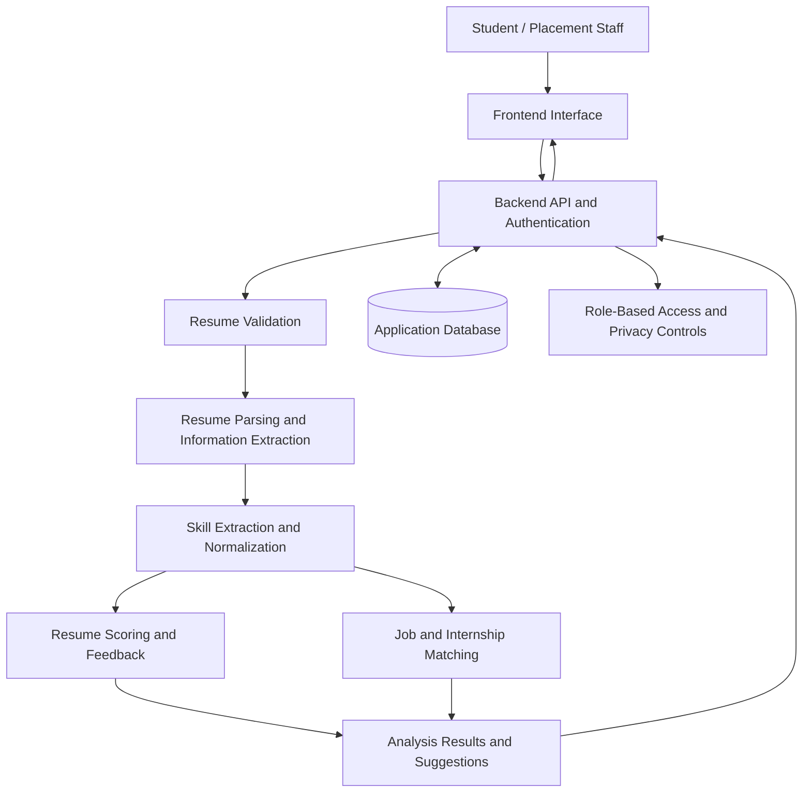
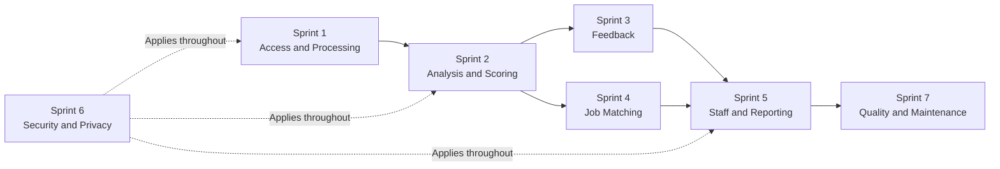

# Resume Analyser for College Placements

**Upload it, understand it, improve it, get placed!**

A resume analysis system designed to help college students prepare for placements and internships. The proposed system extracts information from resumes, identifies skills, evaluates resumes against defined criteria, explains its results, suggests improvements, and compares student profiles with job and internship requirements.

The project is developed as part of **IT314 – Software Engineering** using requirements elicitation, user stories, EPICs, conflict resolution, and Agile Scrum planning.

---

## Table of Contents

- [1. Project Overview](#1-project-overview)
- [2. Problem Statement](#2-problem-statement)
- [3. Target Users](#3-target-users)
- [4. Key Features](#4-key-features)
- [5. How the System Works](#5-how-the-system-works)
- [6. System Architecture](#6-system-architecture)
- [7. Functional and Quality Requirements](#7-functional-and-quality-requirements)
- [8. Technology and Implementation Direction](#8-technology-and-implementation-direction)
- [9. Agile Implementation Roadmap](#9-agile-implementation-roadmap)
- [10. Testing and Success Measures](#10-testing-and-success-measures)
- [11. Security and Responsible Use](#11-security-and-responsible-use)
- [12. IT314 Software Engineering Deliverables](#12-it314-software-engineering-deliverables)
- [13. Team Contributions](#13-team-contributions)
- [14. Future Scope](#14-future-scope)
- [15. Project Status](#15-project-status)

---

## 1. Project Overview

Preparing a good resume is an important part of the college placement process. However, students may not know whether their resumes present their skills clearly, match a particular job description, or contain the information recruiters expect.

The **Resume Analyser for College Placements** aims to address these difficulties through a single platform where students can upload their resumes, review the analysis, understand missing skills, and receive suggestions for improvement.

The system is also intended to support placement officers and career counsellors by providing useful summaries of student resume preparation, with access controlled according to user roles.

### Project Objectives

- Help students understand the strengths and weaknesses of their resumes.
- Extract relevant information, including education, skills, projects, and experience.
- Provide a resume score supported by understandable explanations.
- Suggest practical improvements based on identified issues.
- Compare resumes with job and internship descriptions.
- Identify matching, missing, required, and preferred skills.
- Support placement staff while protecting students' personal information.
- Keep automated analysis as supporting information rather than a replacement for human decisions.

## 2. Problem Statement

Students often prepare resumes without having a clear way to evaluate their quality or suitability for a particular opportunity. General resume templates may help with formatting, but they do not always explain which skills are missing or how closely a resume matches a specific job description.

Placement officers may also find it difficult to review many student resumes individually, while recruiters need to identify relevant qualifications efficiently.

The project proposes a system that makes resume analysis more understandable and organized. Instead of showing only a score, it aims to explain the factors behind the result and help students decide what to improve next.

## 3. Target Users

| User | Main Need |
|---|---|
| Students / Job Seekers | Analyse resumes, identify weaknesses, and improve placement readiness. |
| Placement Officers | Review student analysis and access placement-related summaries. |
| Faculty / Career Counsellors | Guide students using understandable resume feedback. |
| Recruiters / Hiring Managers | Review relevant skills and job-description matches. |
| System Administrators | Manage user roles and access permissions. |
| Data Privacy / Fairness Reviewers | Review data handling and the responsible use of automated results. |

## 4. Key Features

### 4.1 Resume Upload and Processing

- Allow users to upload supported resume files.
- Validate files before processing.
- Extract available information from readable resumes.
- Display a useful error message when a file cannot be processed.

### 4.2 Resume Analysis and Scoring

- Identify skills and relevant resume sections.
- Evaluate resumes using defined criteria.
- Provide an overall resume score.
- Highlight strengths and areas that need improvement.

### 4.3 Feedback and Explainability

- Suggest improvements based on the analysis.
- Explain the main factors behind a score or recommendation.
- Present feedback in language that students can understand.

### 4.4 Job and Internship Matching

- Compare resume information with a supplied job description.
- Identify matching and missing skills.
- Distinguish required skills from preferred skills when this information is available.
- Present relevant opportunities when suitable job or internship data is available.

### 4.5 Placement Staff Support

- Allow authorized staff to view student analysis.
- Provide placement-related summaries and reports.
- Restrict access to information according to the user's role.

### 4.6 Security and Responsible Use

- Protect uploaded resumes and personal information.
- Apply role-based access controls.
- Keep scoring and matching factors reviewable.
- Ensure that automated scores do not independently determine placement or recruitment outcomes.

## 5. How the System Works

The following flow describes the proposed user journey.

**Main workflow:** Upload → Extract → Analyse → Explain → Match → Improve.

The system should also provide an appropriate way to report unreadable information, since extraction may not always be completely accurate.

## 6. System Architecture

The proposed architecture separates the user interface, backend services, resume-processing components, and data storage. This makes individual components easier to develop, test, and maintain.

### Component Responsibilities

| Component | Responsibility |
|---|---|
| Frontend | Resume upload, analysis results, feedback, and job matching views. |
| Backend API | Handles requests, validation, authentication, and communication between components. |
| Resume Parser | Extracts readable text and relevant sections from uploaded files. |
| Skill Extraction | Identifies and normalizes skills from resume content. |
| Scoring and Feedback | Evaluates the resume against defined criteria and explains the result. |
| Matching Engine | Compares extracted resume information with job requirements. |
| Database | Stores necessary user, analysis, and job-related information. |
| Access Control | Restricts access to data and features based on user roles. |

The diagram represents the intended design. Actual component behaviour and integrations should be documented as implementation progresses.

## 7. Functional and Quality Requirements

### Functional Requirements

The main functional requirements are grouped below. Detailed requirement IDs should remain consistent with the project's requirements document.

| Area | Expected Behaviour |
|---|---|
| Resume Upload | Accept supported files and validate them before processing. |
| Information Extraction | Extract education, skills, projects, and experience where available. |
| Resume Analysis | Evaluate the resume using defined criteria. |
| Scoring | Display an overall score and supporting information. |
| Feedback | Highlight improvement areas and provide suggestions. |
| Job Matching | Compare resumes with job descriptions and identify relevant skills. |
| Staff Dashboard | Provide authorized staff with useful student analysis and summaries. |
| User Access | Apply authentication and role-specific permissions. |

### Non-Functional Requirements

- **Usability:** Results and recommendations should be easy to understand.
- **Performance:** Resume processing should complete within an acceptable time for supported files.
- **Security:** Resume information should be protected against unauthorized access.
- **Reliability:** Invalid files and processing failures should be handled clearly.
- **Maintainability:** Parsing, scoring, and matching should be separated into manageable components.
- **Consistency:** The same resume and evaluation criteria should produce consistent results where the analysis method is deterministic.
- **Explainability:** The system should provide understandable reasons for its recommendations.
- **Privacy:** Only necessary information should be collected, displayed, and retained.

### Domain Requirements

The system should account for the following rules:

- Job descriptions may contain both required and preferred skills.
- Equivalent skill names should be handled where appropriate.
- A resume score should not be treated as a guarantee of selection.
- Automated analysis should support, not replace, human judgement.
- Student data must be handled according to defined privacy and access rules.

## 8. Technology and Implementation Direction

The final technology stack should reflect what the team can implement, test, and maintain. The following is a possible implementation direction, not a claim that every component is already operational.

| Layer | Possible Technology | Purpose |
|---|---|---|
| Frontend | React | Build the user interface. |
| Backend | Python with FastAPI | Develop APIs and connect processing components. |
| Resume Processing | PyMuPDF or `python-docx` | Extract text from supported document formats. |
| NLP / ML | Python NLP libraries and suitable embedding models | Extract skills and compare resume content. |
| Database | PostgreSQL | Store application data and structured analysis results. |
| Version Control | Git and GitHub | Manage source code and team collaboration. |
| Testing | Pytest and API testing tools | Verify component behaviour and API responses. |
| Deployment | Docker, if adopted | Support a consistent deployment environment. |

Technology choices should be finalized before implementation. Any library or service used should be evaluated for accuracy, compatibility, privacy, and maintenance requirements.

## 9. Agile Implementation Roadmap

The project is organized into seven planned sprints. Each sprint focuses on a related group of user stories and requirements.

| Sprint | Focus | Main Deliverables |
|---|---|---|
| Sprint 1 | User Access and Resume Processing | Login, resume upload, parsing, and invalid-file handling. |
| Sprint 2 | Resume Analysis and Scoring | Skill extraction, analysis criteria, and overall score. |
| Sprint 3 | Feedback and Explainability | Improvement areas, suggestions, and score explanations. |
| Sprint 4 | Job / Internship Matching | Job-description comparison, opportunities, and matching/missing skills. |
| Sprint 5 | Placement Staff Access and Reporting | Staff views, placement dashboard, and summaries. |
| Sprint 6 | Security, Privacy, and Responsible Use | Access controls, privacy rules, human oversight, and fairness checks. |
| Sprint 7 | Quality and Maintainability | Component cleanup, testing, documentation, and maintainability improvements. |

### Sprint Dependencies

Security and privacy are included as a dedicated workstream in Sprint 6, but they must be considered from the beginning and throughout every sprint. The sprint plan is a development roadmap; completion should be recorded only after the relevant work has been implemented and checked.

## 10. Testing and Success Measures

The system should be evaluated using practical checks rather than relying only on whether the interface works.

| Area | How It Can Be Evaluated |
|---|---|
| Resume Upload | Percentage of supported test files uploaded successfully. |
| Parsing | Accuracy of extracted fields against manually checked sample resumes. |
| Skill Extraction | Precision and recall on a labelled set of skills, where feasible. |
| Scoring | Consistency and usefulness of scores against defined evaluation criteria. |
| Job Matching | Relevance of matched and missing skills for sample job descriptions. |
| Error Handling | Correct handling of empty, unsupported, corrupted, or unreadable files. |
| Usability | Feedback from students and counsellors using the prototype. |
| Performance | Time taken to process supported resumes under defined test conditions. |
| Privacy and Access | Tests confirming that unauthorized users cannot access restricted information. |

### Initial Success Criteria

- Supported resume files can be uploaded and processed.
- Users can review extracted information and understand processing errors.
- Analysis results include a score and useful supporting feedback.
- Job matching identifies relevant and missing skills for test cases.
- Users can understand the reasons behind major recommendations.
- Role-based access and privacy rules are tested.
- Student feedback indicates whether the analysis is understandable and useful.

Actual measurements, accuracy values, and user feedback should be added after testing. They should not be reported as achieved results before evidence is collected.

## 11. Security and Responsible Use

Resumes may contain personal contact details, education history, and employment information. Protecting this information is an important part of the design.

The project should follow these principles:

1. **Access control:** Restrict student and staff information to authorized users.
2. **Data minimization:** Collect and display only information needed for the feature.
3. **Secure handling:** Protect uploaded files and stored data against unauthorized access.
4. **Transparent results:** Explain the main factors behind scores and recommendations.
5. **Human oversight:** Do not use a score as the sole basis for rejecting a candidate.
6. **Fairness:** Avoid unjustified differences based on characteristics unrelated to job requirements.
7. **Data retention:** Define how long uploaded resumes and analysis results are retained and how they can be deleted.

These are design and implementation objectives that should be verified through testing and review.

## 12. IT314 Software Engineering Deliverables

The project covers the main Software Engineering activities required for understanding and designing the system.

### 12.1 Identify Stakeholders and End Users

Identify the people who use, manage, or are affected by the system, including students, placement officers, counsellors, recruiters, and administrators.

### 12.2 Identify Elicitation Techniques

Select suitable techniques for understanding stakeholder needs, such as interviews, surveys, observation, document analysis, brainstorming, workshops, and prototyping.

### 12.3 Apply Elicitation Techniques

Use elicitation activities to identify:

- Functional requirements
- Non-functional requirements
- Domain requirements
- User expectations and constraints

Any claims about interviews, surveys, or stakeholder feedback should be supported by the activities actually conducted.

### 12.4 Write User Stories

Represent requirements from the user's perspective using:

- Role
- Goal
- Benefit
- Acceptance criteria

### 12.5 Create EPICs

Group related user stories into larger functional areas, including resume processing, analysis, feedback, matching, staff reporting, security, and maintainability.

### 12.6 Identify and Resolve Conflicts

Document conflicting stakeholder needs and explain how they can be balanced. Examples include detailed feedback versus processing time, staff access versus student privacy, and automated efficiency versus human decision-making.

These deliverables provide traceability from stakeholder needs to requirements, user stories, and the sprint plan.

## 13. Team Contributions

**Course:** IT314 – Software Engineering

### 13.1 Documentation and Requirements Analysis

| **Name & ID** | **Work Done** |
|---|---|
| **Sujal Balva** 202401216 | • Identified stakeholders and end users |
| **Tanishk Dhawan** 202401224 | • Identified requirement-elicitation techniques • Identified and documented requirement conflicts |
| **Topaliya Shlok Ashokbhai** 202401229 | • Identified requirement-elicitation techniques • Developed user stories |
| **Trivedi Atharv** 202401230 | • Identified requirement-elicitation techniques • Identified and documented requirement conflicts |
| **Vamja Krish Pravinbhai** 202401239 | • Applied elicitation techniques to gather requirements |
| **Nakum Tanvi Dhiren** 202401262 | • Identified stakeholders and end users • Contributed to EPIC generalization |
| **Solanki Taniskumar Mehulbhai** 202401264 | • Applied elicitation techniques to gather requirements • Developed user stories |
| **Tejot Harshil Rajendrabhai** 202401265 | • Applied elicitation techniques to gather requirements • Contributed to EPIC generalization |
| **Krish Hitendrakumar Paghadar** 202401429 | • Identified stakeholders and end users |
| **Prerak Patel** 202401452 | • Applied elicitation techniques to gather requirements • Identified and documented requirement conflicts |

### 13.2 Software Development and Implementation

The following areas represent the planned development work for the project. Individual responsibilities and completed contributions will be added as implementation progresses.

| **Development Area** | **Planned Work** | **Status** |
|---|---|---|
| Frontend Development | • Develop the user interface • Build resume upload, analysis results, and feedback screens | Pending |
| Backend Development | • Develop backend APIs • Connect frontend features with processing and analysis services | Pending |
| Resume Parsing | • Extract text and relevant information from resumes • Handle invalid or unreadable files | Pending |
| AI/ML and Skill Extraction | • Identify and normalize resume skills • Develop resume analysis and scoring logic | Pending |
| Feedback and Explainability | • Generate improvement suggestions • Explain scores and analysis results | Pending |
| Job and Internship Matching | • Compare resumes with job descriptions • Identify matching and missing skills | Pending |
| Database Development | • Design the database schema • Integrate application data storage | Pending |
| Authentication and Security | • Implement login and role-based access • Protect resumes and personal information | Pending |
| Testing and Evaluation | • Test individual components and complete workflows • Evaluate parsing, scoring, and matching | Pending |
| Integration and Deployment | • Integrate frontend, backend, database, and AI/ML components • Prepare deployment and setup instructions | Pending |

### 13.3 Project Tasks Covered

1. **Identify Stakeholders and End Users**
2. **Identify Elicitation Techniques**
3. **Apply the Elicitation Techniques**
   - Functional requirements
   - Non-functional requirements
   - Domain requirements
4. **Write User Stories**
   - Role
   - Goal
   - Benefit
   - Acceptance criteria
5. **Create EPICs**
   - Generalization and grouping of related user stories
6. **Identify and Resolve Conflicts**
   - Identification of conflicting requirements
   - Discussion and resolution of conflicts
7. **Software Development and Implementation**
   - Frontend and backend development
   - Resume parsing and AI/ML analysis
   - Database integration and job matching
   - Security, testing, and deployment

**Note:** The implementation areas describe planned work and are not yet recorded as completed contributions. This section will be updated with the responsible team members and their actual work as development progresses.

## 14. Future Scope

After the core system is implemented and evaluated, possible extensions include:

- More accurate resume parsing for different layouts and document formats.
- Improved skill extraction using NLP and domain-specific skill dictionaries.
- Semantic matching between resume content and job descriptions.
- Resume version history and comparison.
- Additional guidance tailored to different roles and industries.
- Integration with placement portals, subject to available APIs and institutional approval.
- Improved analytics for placement staff, with appropriate privacy controls.
- Broader testing for accessibility, fairness, and performance.

These extensions depend on the project's scope, available data, time, and evaluation results.

## 15. Project Status

The project is being developed as an IT314 Software Engineering project, with requirements analysis, user stories, conflict resolution, and sprint planning forming the basis for implementation.

The seven-sprint roadmap describes the intended development sequence. Features should be marked as completed only when they have been implemented and verified.

**Project principle:** Help students improve their resumes through understandable analysis and useful feedback, while keeping student data protected and final placement decisions under human control.
