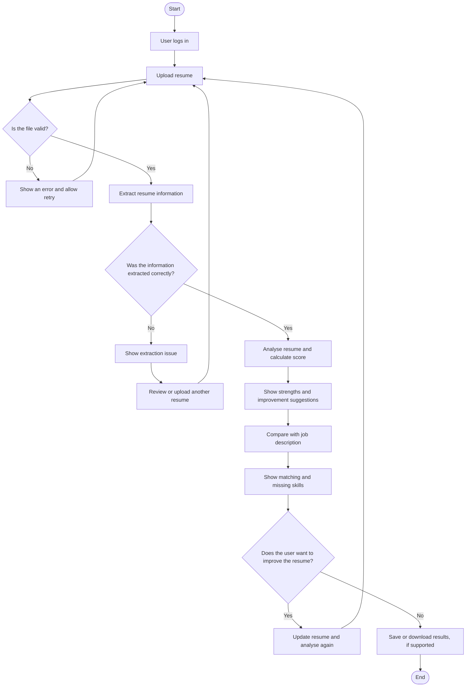

# Resume Analyser for College Placements

**Subject:** IT314 – Software Engineering  
**Instructor:** Prof. Saurabh Tiwari  
**Mentor:** Dhruvil Mehta

**Upload it, understand it, improve it, get placed!**

## Team Members

| Name | Student ID |
|---|---:|
| Nakum Tanvi Dhiren (Team Leader) | 202401262 |
| Sujal Balva | 202401216 |
| Tanishk Dhawan | 202401224 |
| Topaliya Shlok Ashokbhai | 202401229 |
| Trivedi Atharv | 202401230 |
| Vamja Krish Pravinbhai | 202401239 |
| Solanki Taniskumar Mehulbhai | 202401264 |
| Tejot Harshil Rajendrabhai | 202401265 |
| Krish Hitendrakumar Paghadar | 202401429 |
| Prerak Patel | 202401452 |

## 1. Project Overview

The **Resume Analyser for College Placements** is a proposed tool that helps college students prepare for placements and internships. It analyses resume formatting and skill relevance, then compares student profiles with job and internship clusters based on profile similarity. It also provides feedback and practical suggestions to help students improve their resumes.

The platform aims to make resume evaluation more structured and understandable. Students can review their resume analysis, identify missing skills, and learn which areas may need improvement. The system may also support placement officers and career counsellors by providing useful summaries, with access controlled according to user roles.

## 2. Problem Statement

Students may find it difficult to assess the quality of their resumes, identify areas that need improvement, or understand how well their skills match specific job and internship opportunities. General resume templates can help with formatting, but they do not always explain which skills are missing or how closely a resume matches a particular job description.

Reviewing a large number of student resumes manually can also be time-consuming for placement officers and recruiters. This project aims to make resume analysis more organized and understandable by providing a score, explaining the main factors behind the result, and suggesting practical improvements.

## 3. Proposed Tentative Solution

The proposed system will allow students to upload their resumes, extract relevant information, analyse formatting and skills, and receive a score with feedback and improvement suggestions. Students will also be able to compare their profiles with job or internship requirements and identify matching and missing skills.

The system is intended to support placement preparation. Automated scores and recommendations should assist users, not replace human judgement or final placement decisions.

## 4. Project Objectives and Key Features

- **Resume upload and validation:** Accept supported resume files and provide clear messages for invalid or unreadable files.
- **Resume information extraction:** Extract available details such as education, skills, projects, and experience.
- **Resume analysis and scoring:** Evaluate resumes against defined criteria and provide an overall score.
- **Feedback and improvement suggestions:** Highlight strengths and areas that need improvement, with understandable explanations.
- **Job and internship matching:** Compare resume information with job descriptions and identify matching, missing, required, and preferred skills where the information is available.
- **Placement staff support:** Provide relevant summaries to authorized placement staff while protecting students' personal information.
- **Responsible use:** Keep automated analysis transparent and use it as supporting information rather than as the sole basis for placement or recruitment decisions.

## 5. How the System Works

The following flow describes the proposed user journey:

**Main workflow:** Upload → Extract → Analyse → Explain → Match → Improve.

Resume extraction may not always be completely accurate, so the system should provide a way to report or review unreadable or incorrectly extracted information.

## 6. Proposed System Architecture

The proposed architecture separates the user interface, backend services, resume-processing components, and data storage. This separation is intended to make the components easier to develop, test, and maintain.

### Component Responsibilities

| Component | Responsibility |
|---|---|
| Frontend | Provides resume upload, analysis results, feedback, and job-matching views. |
| Backend API | Handles requests, validation, authentication, and communication between components. |
| Resume Parser | Extracts readable text and relevant sections from uploaded files. |
| Skill Extraction | Identifies and normalises skills from resume content. |
| Scoring and Feedback | Evaluates resumes against defined criteria and explains the results. |
| Matching Engine | Compares extracted resume information with job requirements. |
| Database | Stores necessary user, analysis, and job-related information. |
| Access Control | Restricts access to data and features according to user roles. |

This diagram represents the intended design. Actual component behaviour and integrations will be documented as implementation progresses.

## 7. Technology Stack

The technology stack is tentative and may change as the project develops. The final choices will depend on what the team can implement, test, and maintain.

| Layer | Proposed Technology | Purpose |
|---|---|---|
| Frontend | 
| Backend | 
| Resume Processing |
| NLP and Profile Matching |
| Database |
| Version Control | Git and GitHub | Manage source code and support team collaboration. |
| Testing |
| Deployment |

Any library or service adopted should be evaluated for accuracy, compatibility, privacy, and maintainability.

## 8. How to Run Locally

## 9. Team Contributions

See [documents/contributions.md](documents/contributions.md) for details of individual team contributions.

## 10. Future Scope

After the core system has been implemented and evaluated, possible extensions include:

- Improving resume parsing for different layouts and document formats.
- Enhancing skill extraction with NLP and domain-specific skill dictionaries.
- Improving semantic matching between resume content and job descriptions.
- Adding resume version history and comparison.
- Providing guidance tailored to different roles and industries.
- Integrating with placement portals, subject to API availability and institutional approval.
- Improving placement analytics while maintaining appropriate privacy controls.
- Expanding testing for accessibility, fairness, and performance.

These extensions will depend on the project's scope, available data, time, and evaluation results.
