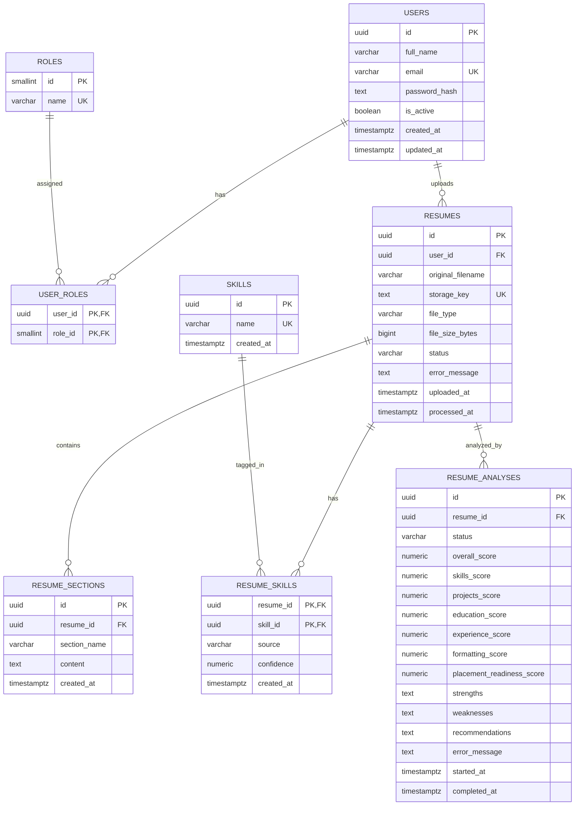

# Resume Analyzer — Database

PostgreSQL database schema covering Sprint 1 and Sprint 2.

---

## Sprint 1 — User Accounts & Resume Upload

Covers user stories **US-01 to US-04**.

| User Story | Description |
|---|---|
| US-01 | Account data, authentication support, and role mapping |
| US-02 | Uploaded resume metadata |
| US-03 | Parsed resume sections |
| US-04 | Resume processing status and readable error messages |

### Tables

| Table | Purpose |
|---|---|
| `users` | Student and officer accounts |
| `roles` | Role catalog (`student`, `placement_officer`, `admin`) |
| `user_roles` | Many-to-many user ↔ role mapping |
| `resumes` | Resume file metadata and processing status |
| `resume_sections` | Parsed resume content (education, skills, experience, etc.) |

---

## Sprint 2 — Resume Analysis & Scoring

Covers user stories **US-05 to US-08**.

| User Story | Description |
|---|---|
| US-05 | Skill extraction and tagging from resume content |
| US-06 | Section-wise scoring (skills, projects, education, experience, formatting) |
| US-07 | Placement readiness score calculation |
| US-08 | AI-generated strengths, weaknesses, and recommendations |

### Tables

| Table | Purpose |
|---|---|
| `skills` | Master catalog of placement-relevant skills (25 pre-seeded) |
| `resume_skills` | Links resumes to extracted/manual skills with confidence scores |
| `resume_analyses` | Full AI analysis result with sub-scores and feedback text |

---

## Database Setup

1. Make sure PostgreSQL 18 is running and the `resume_analyzer` database exists.
2. Open the pgAdmin Query Tool for `resume_analyzer`, or use `psql`.

### Fresh setup (both sprints)

Applies all tables in one shot:

```bash
psql -U postgres -d resume_analyzer -f database/schema.sql
```

### Incremental migrations (sprint by sprint)

Run migration files in order on an existing database:

```bash
# Sprint 1 — run first
psql -U postgres -d resume_analyzer -f database/migration/sprint1_schema.sql

# Sprint 2 — run after Sprint 1
psql -U postgres -d resume_analyzer -f database/migration/sprint2_schema.sql
```

Replace `postgres` with your PostgreSQL username if different.

> **Note:** All files use `CREATE TABLE IF NOT EXISTS` and `ON CONFLICT DO NOTHING`, so they are safe to re-run in any order without causing errors.

---

## Entity Relationship Diagram (ERD)



The editable Mermaid source is also available in [`erd.mmd`](erd.mmd).

---

## Important Design Decisions

- **Private file storage:** PDF and DOCX files are stored in private file storage, not directly in PostgreSQL. The `storage_key` column references the stored file. Coordinate the storage-key format with the backend team.
- **Password security:** Never store plain-text passwords. `password_hash` must contain a secure hash generated by the authentication/backend layer.
- **Parsed content:** `resume_sections` stores extracted sections such as education, skills, projects, and experience.
- **Processing errors:** `resumes.status` and `error_message` allow the application to track processing outcomes and report invalid or unreadable files.
- **Skill confidence:** `resume_skills.confidence` (0.0–1.0) reflects how certain the AI is that a skill was found. `source` distinguishes AI-extracted skills from manually added ones.
- **Analysis scores:** All score columns in `resume_analyses` are `NUMERIC(5,2)` constrained to 0–100. A `NULL` score means the analysis has not yet completed.
- **Data integrity:** UUID identifiers, foreign keys, constraints, indexes, and timezone-aware `TIMESTAMPTZ` columns are used throughout.
- **Safe reruns:** `CREATE TABLE IF NOT EXISTS` and conflict-safe inserts support rerunning any schema file without errors.
- **File size:** Resume files must be greater than 0 bytes and no larger than 5 MiB (5,242,880 bytes), enforced by a database constraint.

---

## Backend Integration Notes

- Store uploaded files outside the database in private storage; save the reference in `resumes.storage_key`.
- Use `resume_sections` for parsed resume content.
- Update `resumes.status` and `error_message` when processing succeeds or fails.
- Populate `resume_skills` with extracted skills and their confidence scores after parsing.
- Insert a row into `resume_analyses` with `status = 'processing'` when analysis starts; update all score and feedback columns and set `status = 'completed'` (or `'failed'`) when done.
- Keep authentication and role assignment consistent with `users`, `roles`, and `user_roles`.
