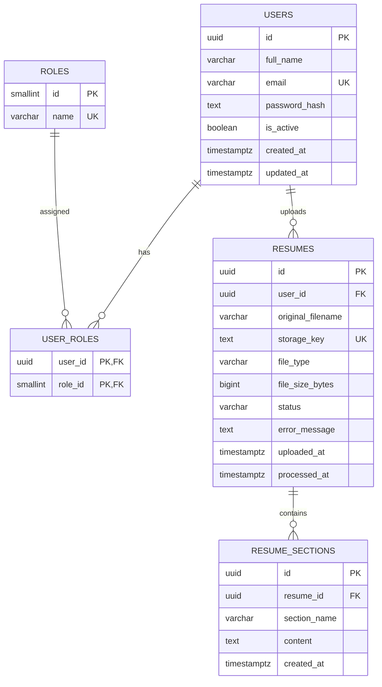

# Resume Analyzer — Sprint 1 Database

PostgreSQL database schema for Sprint 1 user stories US-01 to US-04.

- **US-01:** Account data, authentication support, and role mapping
- **US-02:** Uploaded resume metadata
- **US-03:** Parsed resume sections
- **US-04:** Resume processing status and readable error messages

## Database Setup

1. Make sure PostgreSQL 18 is running and the `resume_analyzer` database exists.
2. Open the pgAdmin Query Tool for `resume_analyzer`, or use `psql`.
3. Execute the `schema.sql` file.

### Using the terminal

Run this command from the project root:

```bash
psql -U postgres -d resume_analyzer -f database/schema.sql
```

Replace `postgres` with your PostgreSQL username if it is different.

## Entity Relationship Diagram (ERD)

The following diagram shows the relationships between the database tables.



The editable Mermaid source is also available in [`erd.mmd`](erd.mmd).

## Important Design Decisions

- **Private file storage:** PDF and DOCX files are stored in private file storage, not directly in PostgreSQL. The `storage_key` column references the stored file. Coordinate the storage-key format with the backend team.
- **Password security:** Never store plain-text passwords. `password_hash` must contain a secure hash generated by the authentication/backend layer.
- **Parsed content:** `resume_sections` stores extracted sections such as education, skills, projects, and experience.
- **Processing errors:** `resumes.status` and `error_message` allow the application to track processing outcomes and report invalid or unreadable files.
- **Data integrity:** UUID identifiers, foreign keys, constraints, indexes, and timezone-aware `TIMESTAMPTZ` columns are used.
- **Safe reruns:** `CREATE TABLE IF NOT EXISTS` and conflict-safe default role inserts support rerunning the schema. However, rerunning the script does not automatically update existing tables or constraints; use a migration for changes to an existing database.
- **File size:** Resume files must be greater than 0 bytes and no larger than 5 MiB (5,242,880 bytes), enforced by database constraints.

## Backend Integration Notes

- Store uploaded files outside the database in private storage.
- Save the file's storage reference and metadata in `resumes`.
- Use `resume_sections` for parsed resume content.
- Update the resume status and error message when processing succeeds or fails.
- Keep authentication and role assignment consistent with `users`, `roles`, and `user_roles`.

## Future Improvements

Keep Sprint 1 focused on account access, resume upload, parsing, and invalid-file handling. Add future analysis-related tables through separate migrations when the relevant user stories are defined.