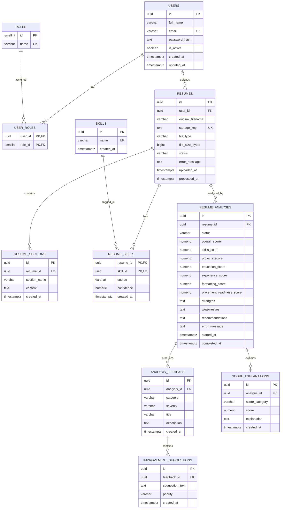

# Resume Analyzer — Database

PostgreSQL 18 database schema covering Sprint 1, Sprint 2, and Sprint 3.

---

## Sprint 1 — User Accounts & Resume Upload

Covers user stories **US-01 to US-04**.

| User Story | Description |
|---|---|
| US-01 | Account data, authentication support, and role mapping |
| US-02 | Uploaded resume metadata |
| US-03 | Parsed resume sections |
| US-04 | Resume processing status and readable error messages |

### Tables

| Table | Purpose |
|---|---|
| `users` | Student and officer accounts |
| `roles` | Role catalog (`student`, `placement_officer`, `admin`) |
| `user_roles` | Many-to-many user ↔ role mapping |
| `resumes` | Resume file metadata and processing status |
| `resume_sections` | Parsed resume content (education, skills, experience, etc.) |

---

## Sprint 2 — Resume Analysis & Scoring

Covers user stories **US-05 to US-07** and analysis-related functionality of US-08.

| User Story | Description |
|---|---|
| US-05 | Skill extraction and tagging from resume content |
| US-06 | Section-wise scoring (skills, projects, education, experience, formatting) |
| US-07 | Placement readiness score calculation |
| US-08 | AI-generated strengths, weaknesses, and recommendations |

### Tables

| Table | Purpose |
|---|---|
| `skills` | Master catalog of placement-relevant skills (25 pre-seeded) |
| `resume_skills` | Links resumes to extracted/manual skills with confidence scores |
| `resume_analyses` | Full analysis result with sub-scores, strengths, weaknesses, and recommendations |

---

## Sprint 3 — Feedback & Explainability

Covers user stories **US-08 to US-10**.

| User Story | Description |
|---|---|
| US-08 | Identify areas that need improvement |
| US-09 | Get resume improvement suggestions |
| US-10 | Understand the score and recommendations |

### Requirements

- FR-06: Identify important areas for improvement.
- FR-07: Provide improvement suggestions.
- FR-11: Provide explanations for important results.
- NFR-05: Recommendations and important results should be understandable.
- NFR-08: Interface should be readable and accessible.

### Tables

| Table | Purpose |
|---|---|
| `analysis_feedback` | Stores resume analysis feedback, improvement areas, category, and severity |
| `improvement_suggestions` | Stores actionable improvement suggestions linked to feedback |
| `score_explanations` | Stores explanations for overall and category-wise scores |

### Feedback Categories

`skills`, `projects`, `education`, `experience`, `formatting`, `general`

### Feedback Severity & Suggestion Priority

`low`, `medium`, `high`

### Score Categories

`overall`, `skills`, `projects`, `education`, `experience`, `formatting`, `placement_readiness`

Scores are constrained to the range 0–100.

---

## Database Setup

Make sure PostgreSQL 18 is running and the `resume_analyzer` database exists.

Open the pgAdmin Query Tool for `resume_analyzer`, or use `psql`.

### Fresh Setup (All Sprints)

Applies all tables and seed data in one shot:

```bash
psql -U postgres -d resume_analyzer -f database/schema.sql
```

### Incremental Migrations (Sprint by Sprint)

Run migration files in order on an existing database:

```bash
# Sprint 1 — run first
psql -U postgres -d resume_analyzer -f database/migration/sprint1_schema.sql

# Sprint 2 — run after Sprint 1
psql -U postgres -d resume_analyzer -f database/migration/sprint2_schema.sql

# Sprint 3 — run after Sprint 2
psql -U postgres -d resume_analyzer -f database/migration/sprint3_feedback.sql
```

Replace `postgres` with your PostgreSQL username if different.

**Note:** Schema and migration files use `CREATE TABLE IF NOT EXISTS` and conflict-safe inserts where applicable. However, migrations must be executed in dependency order because foreign keys reference tables created in earlier sprints. `CREATE TABLE IF NOT EXISTS` does not modify existing tables.

---

## Entity Relationship Diagram (ERD)



The editable Mermaid source is also available in [`erd.mmd`](erd.mmd).

---

## Important Design Decisions

- **Private file storage:** PDF and DOCX files are stored in private file storage, not directly in PostgreSQL. The `storage_key` column references the stored file. Coordinate the storage-key format with the backend team.
- **Password security:** Never store plain-text passwords. `password_hash` must contain a secure hash generated by the authentication/backend layer.
- **Parsed content:** `resume_sections` stores extracted sections such as education, skills, projects, and experience.
- **Processing errors:** `resumes.status` and `error_message` allow the application to track processing outcomes and report invalid or unreadable files.
- **Skill confidence:** `resume_skills.confidence` (0.0–1.0) reflects how certain the AI is that a skill was found. `source` distinguishes AI-extracted skills from manually added ones.
- **Analysis scores:** All score columns in `resume_analyses` are `NUMERIC(5,2)` constrained to 0–100. A `NULL` score means the analysis has not yet completed.
- **Feedback:** `analysis_feedback` records improvement areas by category and severity. Each feedback entry belongs to an analysis.
- **Improvement suggestions:** `improvement_suggestions` stores actionable suggestions linked to feedback entries.
- **Score explanations:** `score_explanations` stores explanations for individual score categories. Each analysis can have only one explanation per score category.
- **Data integrity:** UUID identifiers, foreign keys, constraints, indexes, and timezone-aware `TIMESTAMPTZ` columns are used throughout.
- **Safe reruns:** `CREATE TABLE IF NOT EXISTS` and conflict-safe inserts support rerunning compatible schema scripts. They do not update existing table definitions.
- **File size:** Resume files must be greater than 0 bytes and no larger than 5 MiB (5,242,880 bytes), enforced by a database constraint.

---

## Backend Integration Notes

- Store uploaded files outside the database in private storage; save the reference in `resumes.storage_key`.
- Use `resume_sections` for parsed resume content.
- Update `resumes.status` and `error_message` when processing succeeds or fails.
- Populate `resume_skills` with extracted skills and their confidence scores after parsing.
- Insert a row into `resume_analyses` with `status = 'processing'` when analysis starts; update scores and analysis feedback fields and set `status = 'completed'` (or `'failed'`) when done.
- Store individual improvement areas in `analysis_feedback`.
- Store actionable suggestions in `improvement_suggestions`, linked to their feedback entry.
- Store score explanations in `score_explanations`, linked to the corresponding analysis and score category.
- Keep authentication and role assignment consistent with `users`, `roles`, and `user_roles`.
